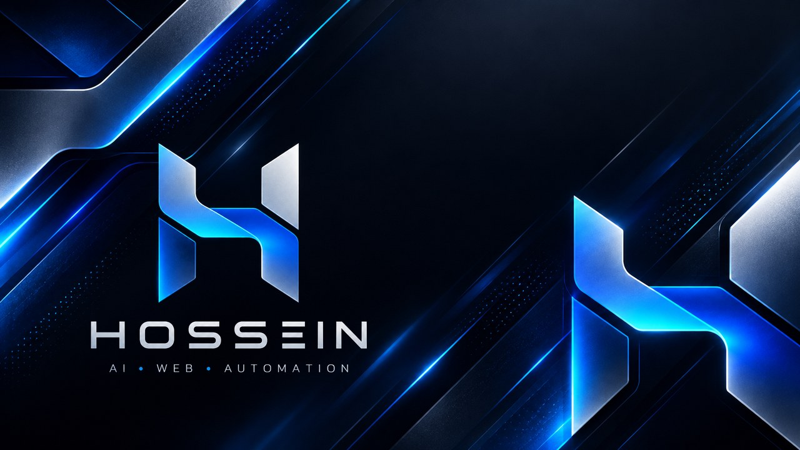

# HAFS
### Hossein AI Freelance System

**From the first client message to final delivery.**

**از دریافت پروژه تا تحویل نهایی؛ یک مسیر روشن، مستند و قابل تأیید برای توسعه پروژه‌های وب.**

**[راهنمای مهاجرت به Next.js](MIGRATION.md) · [Source code](https://github.com/HosseinYazdanpanah/project-ui-ai-x-mrhossein)**

---

## 🚀 HAFS چیست؟ | Overview

**HAFS** یک فضای کاری مرحله‌ای برای مدیریت فرایند پروژه‌های فریلنسری وب است؛ از گفت‌وگوی ابتدایی با کارفرما و تحلیل نیازها تا تعیین معماری، تولید Promptهای اجرایی، ساخت، کنترل کیفیت، استقرار و تحویل. هدف، تبدیل تصمیم‌های پراکنده به روندی **شفاف، قابل پیگیری، مستند و تحت کنترل انسان** است.

**English:** HAFS is a Persian-first freelance web-project workflow system. It organizes discovery, planning, architecture, prompt preparation, execution, quality assurance, security reviews, deployment and handover into an approval-driven workspace.

### Philosophy

| Principle | Meaning |
|:--|:--|
| 🧭 **Plan before Code** | ابتدا نیاز، دامنه، سناریو و معماری؛ سپس پیاده‌سازی |
| 🧑‍⚖️ **Human Approval** | تصمیم‌های مهم باید توسط صاحب پروژه بازبینی و تأیید شوند |
| 🎯 **Business before Features** | هر قابلیت باید مسئله‌ای واقعی را حل کند |
| 🔎 **No invisible assumptions** | درخواست قطعی مشتری با پیشنهاد تخصصی و فرض موقت مخلوط نمی‌شود |
| 🔐 **Security by Design** | کنترل کیفیت و بازبینی امنیتی جزئی از مسیر تحویل است |
| 📦 **Client Ownership** | خروجی و تحویل باید قابل فهم و قابل نگهداری باشد |

## 🧩 Ten-stage project operating system

HAFS یک داشبورد مرکزی و **۱۰ مرحله اصلی** دارد:

| # | Stage | Outcome |
|:--:|:--|:--|
| **01** | **Project Intake** | ثبت درخواست خام، هدف‌ها و محدودیت‌های پروژه |
| **02** | **Client Interview** | پرسش‌های حیاتی، کسب‌وکار، مخاطب و رفع ابهام |
| **03** | **Classification & Site DNA** | تعیین نوع سایت و ماژول‌های موردنیاز |
| **04** | **Scenario & Architecture** | سناریو، صفحات، داده‌ها، APIها و ساختار فنی |
| **05** | **Codex Prompt Pack** | تبدیل تصمیم‌ها به بسته Promptهای اجرایی و مرحله‌ای |
| **06** | **Build** | ثبت و مدیریت فرایند توسعه |
| **07** | **QA #1 + Security #1** | بازبینی کیفیت، عملکرد و امنیت پیش از انتشار |
| **08** | **Preview & Deployment** | بررسی پیش‌نمایش و تصمیم برای Production |
| **09** | **QA #2 + Security #2 + SEO** | آزمون پس از انتشار، عملکرد و بررسی کشف‌پذیری |
| **10** | **Client Handover** | مستندات، دسترسی‌ها، موارد باز و تحویل نهایی |

~~~text
 CLIENT REQUEST
      │
      ▼
 DISCOVERY ──► CLASSIFICATION ──► SITE DNA
      │                              │
      ▼                              ▼
 CLIENT INTERVIEW ─────────► SCENARIO & ARCHITECTURE
                                      │
                                      ▼
                             CODEX PROMPT PACK
                                      │
                                      ▼
                                    BUILD
                                      │
                                      ▼
                               QA / SECURITY #1
                                      │
                                      ▼
                               PREVIEW → RELEASE
                                      │
                                      ▼
                           QA / SECURITY #2 + SEO
                                      │
                                      ▼
                               CLIENT HANDOVER
~~~

> مرحله بعدی باید بر اساس تصمیم و تأیید واقعی انتخاب شود؛ داشتن یک UI برای این مراحل به این معنی نیست که آزمون امنیتی، Deployment یا اجرای Codex **به‌صورت خودکار** انجام شده است.

## ✨ Features

| Feature | What it provides |
|:--|:--|
| 📊 **Project Dashboard** | نمای کلی پروژه، مسیر بعدی و درصد تکمیل |
| 🧠 **Requirements intelligence** | جداسازی نیاز کارفرما، توصیه متخصص، فرض موقت و تصمیم باز |
| 🎤 **Interview workspace** | سوالات Critical / Important / Optional / Technical |
| 🧬 **Website DNA** | طبقه‌بندی معماری و انتخاب ماژول‌ها با توجه به مدل کسب‌وکار |
| 🏛️ **Architecture planning** | ثبت سناریو، صفحات، ماژول‌ها و تصمیم‌های فنی |
| 🤖 **Prompt pack** | آماده‌سازی دستورالعمل‌های مرحله‌ای برای ابزارهایی مانند Codex |
| ✅ **Approval gates** | تأیید مرحله پیش از حرکت به مرحله بعد |
| 💾 **Autosave** | ذخیره‌سازی وضعیت در مرورگر |
| 📤 **Import / Export** | دریافت و بازیابی پروژه به‌صورت JSON |
| 🧪 **QA / Security prompts** | چک‌لیست و راهنمای بررسی پیش و پس از استقرار |
| 📱 **Persian RTL UI** | تجربه فارسی راست‌به‌چپ |
| 💬 **Rubika route** | Endpoint سروری برای وبهوک ربات روبیکا، در صورت تنظیم واقعی Token |

### Requirements: four distinct categories

| Category | Meaning |
|:--|:--|
| **Client Requirement** | خواسته‌ای که کارفرما صریحاً اعلام کرده |
| **Professional Recommendation** | پیشنهادی که تحلیل حرفه‌ای به دست داده |
| **Temporary Assumption** | پیش‌فرضی که هنوز تأیید نشده |
| **Client Decision Required** | موردی که بدون پاسخ مشتری نمی‌تواند نهایی شود |

این تفکیک باعث می‌شود دامنه پروژه (**Scope**) شفاف بماند و قابلیت‌های اضافه بدون نیاز واقعی وارد برنامه نشوند.

## 🏗️ Actual implementation

HAFS اکنون روی **Next.js App Router** اجرا می‌شود. برای حفظ ظاهر و رفتار نسخه اصلی، بخش عمده محیط کاری قبلی به‌شکل **Compatibility Layer** نگه داشته شده است؛ این مهاجرت به معنای بازنویسی کامل رابط قدیمی به React Components نیست.

~~~text
app/
├── layout.tsx             # Persian RTL document and metadata
├── page.tsx               # Server-rendered workspace shell
├── globals.css            # Existing HAFS UI styles
└── api/rubika/route.ts    # Node.js GET / POST webhook

lib/
├── hafs-workspace.ts      # Preserved trusted UI markup
└── rubika.js              # Webhook implementation

public/
├── hafs/runtime.js        # Original interactive workflow code
└── assets/                # Local image assets

legacy/index.static.html   # Previous single-file UI
tests/migration.test.mjs   # Migration/compatibility assertions
MIGRATION.md               # Technical migration details
~~~

**Runtime flow**

~~~text
Next.js server rendering
      ↓
HAFS static workspace markup
      ↓
/hafs/runtime.js in browser
      ↓
Wizard + approvals + UI interaction
      ↓
LocalStorage / JSON import-export
~~~

The Rubika webhook is a separate **Node.js route handler** requiring a supported server runtime. Standard static hosting cannot execute that route.

## ⚡ Run HAFS locally

**Requirements:** Node.js **20.9+** (as declared by the project) and npm.

~~~bash
git clone https://github.com/HosseinYazdanpanah/project-ui-ai-x-mrhossein.git
cd project-ui-ai-x-mrhossein
npm install
npm run dev
~~~

Open `http://localhost:3000`.

| Command | Purpose |
|:--|:--|
| `npm run dev` | Run development server |
| `npm run typecheck` | Validate TypeScript |
| `npm test` | Test migration invariants |
| `npm run build` | Build production application |
| `npm run start` | Start production server |

### Environment

Only the Rubika integration currently declares an environment secret in [`.env.example`](.env.example):

~~~dotenv
RUBIKA_BOT_TOKEN=
~~~

Set the actual token in your private deployment environment or local `.env.local`, **never in GitHub**. Configure the webhook at `https://YOUR_DOMAIN/api/rubika` and verify it against the provider's actual requirements. The rest of the core wizard can be used without a Rubika token.

## 💾 Data model, privacy and backup

**Current project state lives in the browser's LocalStorage.** This is convenient for private prototyping but has important limits:

- It is **not** a shared multi-user database.
- Browser data deletion can erase locally stored work.
- Storage is tied to the origin. When moving domains, export a JSON backup from the old site and import it at the new one.
- Keep exported files private if they contain client names, contact details, credentials or confidential requirements.
- A browser-side project log is **not proof** that an external build, security scan or production verification happened.

Use the built-in JSON export regularly. For team collaboration and durable cloud storage, a permissioned backend and explicit data governance would need to be added.

## ☁️ Deploy

### Vercel (recommended for this runtime)

1. Import the repository from GitHub.
2. Select **Next.js** as the framework (remove any old Static/Other framework overrides).
3. Set `RUBIKA_BOT_TOKEN` if using the webhook.
4. Build with `npm run build`, then verify the home page and API route.
5. Future pushes to the connected `main` branch can deploy automatically.

**GitHub Pages limitation:** The default static-only publishing model does not run the Next.js serverless Rubika webhook.

Read [MIGRATION.md](MIGRATION.md) before altering deployment settings.

## 🧪 Verification checklist

- [ ] Local project loads and displays all 10 workflow stages.
- [ ] A new project can move between stages through approval controls.
- [ ] Browser refresh preserves the local project state.
- [ ] JSON export / import preserves the important project fields.
- [ ] RTL presentation and essential form controls work on mobile and desktop.
- [ ] `npm run typecheck`, `npm test` and `npm run build` succeed.
- [ ] Configured Rubika webhook receives and handles authorized events.
- [ ] Production hosting and domain changes do not silently discard backups.

The repository test suite verifies migration-related **source invariants**. It does not replace a full security audit or end-to-end browser test suite.

## 🛣️ Evolution / Roadmap

- [ ] Progressively migrate legacy DOM behaviors to typed, isolated React components.
- [ ] Add comprehensive UI and accessibility regression tests.
- [ ] Introduce an optional authenticated, shared project backend.
- [ ] Expand import/export integrity validation and versioned backups.
- [ ] Add real integrations only with scoped authorization and explicit user approval.

These describe possible next steps, not implemented production promises.

## 👨‍💻 Project owner

Developed and maintained by [Hossein Yazdanpanah](https://github.com/HosseinYazdanpanah).

**License:** No root `LICENSE` file is currently present in this repository. Source visibility does not automatically grant permission for copying, redistribution or commercial reuse.

## 🧰 Operator's handbook | راهنمای اجرای پروژه

### The handoff contract

Every stage should result in a **reviewable artifact**, not an unverified completion badge:

| Gate | Evidence to review |
|:--|:--|
| Discovery | Explicit client brief, constraints and unresolved questions |
| Architecture | Pages, data, external services and acceptance criteria |
| Prompt pack | Scope-bounded implementation instructions |
| Build | Commit, preview or implementation evidence |
| QA & Security | Findings, test method and remediation status |
| Deployment | Actual environment URL and verified behavior |
| Handover | Deliverables, credentials ownership and remaining work |

An approval in the HAFS interface represents the operator's decision. It does **not** automatically call Codex, publish a website, perform a penetration test or verify a third-party deployment.

### 🔬 Maintenance & release checks

~~~bash
npm run typecheck
npm test
npm run build
~~~

Review the compatibility boundaries before migrating any part of `public/hafs/runtime.js` into React. Retain stable LocalStorage keys or provide a versioned migration; test export/import *before and after* the change. Never place API keys or client credentials into browser storage, test fixtures, screenshots or repository history.

### 🤝 Collaboration model

Keep human approval explicit for external actions, write assumptions separately from confirmed requirements, and document reproducible QA evidence with each substantial change. For Rubika integration, validate authentication and callbacks in the configured Node.js deployment rather than treating the existence of `/api/rubika` as proof of connectivity.

### HAFS · Plan with clarity. Build with confidence. Deliver with proof.

**توسعه بهتر از تصمیم‌های بهتر شروع می‌شود.** ✨

